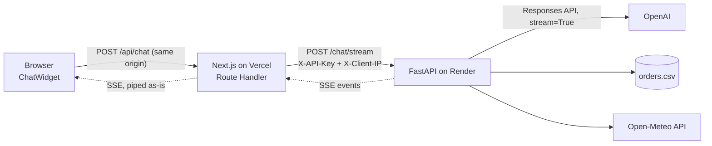

# Smart Copilot

A streaming AI assistant for a small café business: ask in Vietnamese about **orders, sales or the weather**, and it
calls real tools, streams the answer token by token, and renders the tool results as **UI components** (table, chart,
weather card) instead of raw JSON. Ships as an embeddable chat widget.

**Live demo:** https://llm-foundations-notes.vercel.app — try _"Đơn nào của Chi đang giao?"_ or _"Top 3 sản phẩm bán
chạy nhất?"_

> The backend runs on a free Render instance that sleeps after 15 min idle. The first question after a pause takes
> **~1 minute** while it wakes up (the widget says so after 5s).

<!-- Demo GIF: add docs/demo.gif (< 5MB), then uncomment:

-->

## Features

- **Tool calling with an agent loop** — 3 tools: `query_orders` and `sales_summary` (pandas over a 50-order CSV),
  `get_weather` (live data from Open-Meteo). The model may call several tools, in parallel or over several steps,
  capped at 5 steps.
- **Streaming over SSE** — text appears as it is generated; while a tool runs the widget shows "Đang tra đơn hàng…",
  then the component (or ⚠ if the tool failed).
- **Generative UI** — each tool result maps to a React component through a small registry (`OrdersTable`,
  `SalesChart`, `WeatherCard`); unknown tools fall back to compact JSON.
- **Stop button that really stops** — cancelling in the browser aborts the request all the way to FastAPI, so OpenAI
  stops generating and you stop paying.
- **Embeddable widget** — one `<iframe>` on any site (`/embed`).
- **Abuse protection** — API key between frontend and backend, rate limit of 5 requests / minute per client IP,
  `429` with `Retry-After` shown to the user.
- **Cost tracking** — every request logs tokens, cost, time to first token and status (`ok` / `cancelled` / `error`).

## Architecture



The browser only ever talks to its own origin. The Next.js Route Handler holds the backend URL and the shared API key,
adds them server-side and pipes the stream back — **no secret reaches the browser** (checked: none of the shipped JS
contains the backend URL or key names). The OpenAI key lives only on Render.

SSE events (`event: <name>` + `data: <json>`):

| Event         | Data                                                     | UI                                    |
| ------------- | -------------------------------------------------------- | ------------------------------------- |
| `tool_call`   | `call_id`, `name`, `arguments`                           | "Đang tra…" status line               |
| `tool_result` | `call_id`, `name`, `ok`, `data` or `error`               | component, or a warning if `ok:false` |
| `delta`       | `content` (a few characters)                             | appended to the answer                |
| `done`        | `input_tokens`, `output_tokens`, `cost_usd`, `steps`, `incomplete` | usage line                  |
| `error`       | `message`                                                | red error, keeps the text so far      |

## Design decisions and trade-offs

- **SSE, not WebSocket.** Data flows one way (server → client), and every question is a new request. SSE is plain
  HTTP: it works through Vercel, Cloudflare and Render without protocol upgrades, and `fetch` can send headers. The
  cost: no built-in reconnect when reading with `fetch`, and proxies must not buffer (`X-Accel-Buffering: no`).
- **Next.js Route Handler as a proxy** instead of calling FastAPI from the browser: keeps the key server-side, needs
  no CORS (removed from FastAPI entirely), and is the natural place to attach the client IP.
- **Cancellation is opt-in on Vercel.** Without `supportsCancellation` in `vercel.json`, `request.signal` never fires
  and the backend kept generating after Stop. Measured on prod: a stopped 2-tool answer cost **$0.000075** with the
  flag vs **$0.000315** without.
- **Rate limit by the real client IP.** Behind Vercel, FastAPI only sees Vercel's outgoing AWS IPs, which change
  between requests, so the limiter silently stopped working (6 requests, no `429`). Now the Route Handler forwards the
  IP Vercel puts in `x-forwarded-for` (Vercel overwrites client-sent values) as `X-Client-IP`. FastAPI trusts it only
  because the API-key check runs **before** the rate limit.
- **In-memory rate limit.** Simple and enough for one instance; resets on restart and would be wrong with several
  instances (would need Redis).
- **Plain-text answers.** The widget renders text as-is, so the prompt asks for no Markdown instead of adding a
  Markdown renderer. Cheaper, but a prompt is not a guarantee.

## Measured numbers

From production (Vercel + Render) and local runs, model `gpt-6-luna`:

| What                                 | Result                                                   |
| ------------------------------------ | -------------------------------------------------------- |
| First text, no tool                  | 0.5–1.4 s                                                |
| First text with tools                | ~3–7 s (the answer starts after the last tool step)      |
| Full answer, 2 tools, via Vercel     | 4.4 s, 80 deltas spread over the stream (no buffering)   |
| Cost per question                    | ~$0.00005 (no tool) – $0.0003 (2 tools)                  |
| Cold start (free Render instance)    | 50–75 s                                                  |
| Tests                                | backend pytest 12 · frontend Vitest 15                   |

## Known limitations

- **No conversation memory** — each request sends one `message`; follow-up questions don't see earlier turns.
- **Cold start** of ~1 minute on the free Render plan (see above).
- **Cost log file is lost on redeploy/restart** (Render's filesystem is ephemeral). The `[cost]` lines stay in Render
  logs; OpenAI Usage is the source of truth for money.
- **Rate limit:** per instance, in memory; users behind the same public IP share a counter; trusting `X-Client-IP` is
  only safe behind Vercel (self-hosted Next.js keeps a client-sent `x-forwarded-for`).
- **Weather** covers 3 cities (Hà Nội, Đà Nẵng, TP.HCM) and current conditions only, no forecast.
- **Demo data** — orders and sales come from a 50-row sample CSV.

## Tech stack

**Backend:** Python 3.12, FastAPI, OpenAI Responses API, pandas, httpx2 · uv, ruff, pyright, pytest
**Frontend:** Next.js 16 (App Router), React 19, TypeScript, Tailwind CSS 4 · pnpm, ESLint, Vitest
**Hosting:** Render (backend, free web service) · Vercel (frontend, Hobby)

## Run locally

Requires Python 3.12 with [uv](https://docs.astral.sh/uv/), Node.js 20.9+ with pnpm, and an OpenAI API key.

```bash
# Terminal 1 — backend (http://127.0.0.1:8000)
cd backend
cp .env.example .env          # OPENAI_API_KEY=..., APP_API_KEY=<any random string>
uv sync
uv run fastapi dev

# Terminal 2 — frontend (http://localhost:3100)
cd web
cp .env.example .env.local    # APP_API_KEY=<same string>, BACKEND_URL=http://127.0.0.1:8000
pnpm install
pnpm dev
```

- `http://localhost:3100/mock` (dev only) replays scripted streams — happy path, cold start, tool error, mid-stream
  error, unknown tool, `429` — without calling OpenAI.
- Tests: `uv run pytest` in `backend/`, `pnpm test` in `web/`.

## Deploy

| Render (backend)  |                                                   |
| ----------------- | ------------------------------------------------- |
| Root Directory    | `projects/p1-smart-copilot/backend`               |
| Build Command     | `uv sync --frozen && uv cache prune --ci`         |
| Start Command     | `uv run fastapi run` (binds `0.0.0.0`, reads `PORT`) |
| Health Check Path | `/health`                                         |
| Environment       | `OPENAI_API_KEY`, `APP_API_KEY`, `PYTHONUNBUFFERED=1` |

| Vercel (frontend) |                                                   |
| ----------------- | ------------------------------------------------- |
| Root Directory    | `projects/p1-smart-copilot/web` (framework: Next.js) |
| Environment       | `BACKEND_URL` (Render URL, no trailing `/`), `APP_API_KEY` (same as Render) |
| `vercel.json`     | `supportsCancellation: true` for `app/api/chat/route.ts` |

Embed the widget on any page:

```html
<iframe
  src="https://llm-foundations-notes.vercel.app/embed"
  title="Smart Copilot"
  style="position: fixed; right: 0; bottom: 0; width: 420px; height: 640px; max-width: 100vw; border: 0"
></iframe>
```

## Project structure

```
backend/
  app/main.py         POST /chat/stream — agent loop, SSE events, cost log
  app/tools.py        3 tools + schemas + registry (MAX_STEPS = 5)
  app/auth.py         X-API-Key check
  app/rate_limit.py   5 req / 60 s per client IP
  data/orders.csv     sample data
web/
  app/api/chat/route.ts   proxy to FastAPI (key, client IP, cancellation)
  app/embed/              widget-only page for <iframe>
  components/             ChatWidget, ToolView registry, OrdersTable, SalesChart, WeatherCard
  lib/                    SSE parser, event reducer, error mapping (+ Vitest)
embed-test/index.html     a "third-party" page that embeds the widget
```
